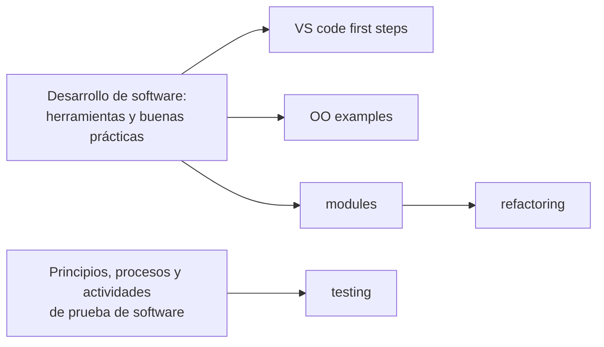

<div align="center">

# Ingeniería del Software · Código de las prácticas

**Ejemplos de código explicados en las clases prácticas de Ingeniería del Software**
**Grado en Inteligencia Artificial · Universidade da Coruña (UDC)**

[](https://www.python.org/)
[](https://docs.pytest.org/)
[](https://code.visualstudio.com/)
[](https://creativecommons.org/licenses/by/4.0/deed.es)


</div>

---

## Qué es este repositorio

Este repositorio reúne el código de los ejemplos que se muestran en las clases prácticas de **Ingeniería del Software** (2º curso del Grado en Inteligencia Artificial de la UDC). Cada ejemplo es pequeño y autocontenido, para que puedas:

- **Ejecutar y modificar** en tu equipo el código visto en clase, en lugar de copiarlo de las diapositivas.
- **Repasar** cada concepto a tu ritmo, siguiendo los ejemplos en orden.
- **Usarlo como referencia** al desarrollar el proyecto en equipo de la asignatura, que se organiza con Scrum y se evalúa, entre otros criterios, por su arquitectura, sus normas de estilo y su plan de pruebas.

El repositorio está publicado en abierto desde 2023 y se amplía con nuevos ejemplos en cada curso.

---

## Relación con el temario



| Carpeta | Contenido | Tema de la asignatura |
|---|---|---|
| [`VS code first steps`](VS%20code%20first%20steps) | Primer programa en Python desde VS Code | Desarrollo de software: herramientas |
| [`OO examples`](OO%20examples) | Programación orientada a objetos en Python, del concepto de clase al polimorfismo | Desarrollo de software: buenas prácticas |
| [`modules`](modules) | Módulos, espacios de nombres, paquetes y refactorización | Desarrollo de software: buenas prácticas |
| [`testing`](testing) | Pruebas unitarias con pytest: valores límite, excepciones, mocks y caja blanca | Pruebas de software |

---

## Contenido en detalle

### `OO examples`: orientación a objetos

Los ficheros están numerados para seguirlos en orden.

| Fichero | Concepto |
|---|---|
| `0_basic_class.py` | Definición de una clase y creación de objetos |
| `1_class_attributes_location.py` | Atributos de clase y atributos de instancia |
| `2_class_attributes_access.py` | Acceso a los atributos |
| `3_class_attributes_access_mangling.py` | Atributos "privados" y *name mangling* |
| `4_class_methods.py` | Métodos de instancia, de clase y estáticos |
| `5_basic_inheritance.py` | Herencia |
| `6_polymorphism.py` | Polimorfismo |
| `7_dataclasses_test.py` | Clases de datos con `@dataclass` |
| `oo_exercise_module.py` · `oo_exercise_script.py` | Ejercicio: la clase en un módulo y su uso desde un script |

### `modules`: organización del código

| Carpeta | Concepto |
|---|---|
| `basic_module` | Dividir un programa en módulos e importarlos |
| `namespaces` | Ámbito de las variables: local, *enclosing* y global |
| `package_example` | Paquetes y subpaquetes (`mates.algebra`, `mates.calculo`) y formas de importarlos |
| `refactoring` | El mismo programa antes (`main.py`) y después (`main_refactored.py`) de refactorizarlo |

### `testing`: pruebas de software

| Carpeta | Técnica de prueba |
|---|---|
| `0_basic_testing` | Primera prueba unitaria con pytest |
| `1_limit_values_testing` | Pruebas de valores límite |
| `2_exceptions_testing` | Pruebas de casos de error y excepciones |
| `3_mock_testing` | Sustitución de dependencias con *stubs* y *mocks* (`unittest.mock`) |
| `4_white_box_testing` | Pruebas de caja blanca: una prueba por cada camino independiente |

---

## Cómo usarlo

**1. Clona el repositorio**

```bash
git clone https://github.com/aalvarell/is-practice-code-samples.git
cd is-practice-code-samples
```

**2. Ábrelo en VS Code**

Abre el fichero `practice.code-workspace` (*File > Open Workspace from File...*). El espacio de trabajo aplica automáticamente el formato PEP 8 con autopep8.

**3. Ejecuta un ejemplo**

Ejecuta cada ejemplo desde su propia carpeta, para que las importaciones entre módulos funcionen:

```bash
cd "OO examples"
python 0_basic_class.py
```

**4. Ejecuta las pruebas**

Instala pytest y lanza las pruebas de una carpeta o de todas a la vez:

```bash
pip install pytest
pytest testing/0_basic_testing   # una carpeta
pytest testing                   # todas las pruebas
```

---

## Autoría y licencia

Material elaborado por el profesorado de Ingeniería del Software del Grado en Inteligencia Artificial de la Universidade da Coruña:

- **Alberto Alvarellos González**
- **Santiago Rodríguez Yáñez**

Este material se distribuye con licencia [Creative Commons Reconocimiento 4.0 Internacional (CC BY 4.0)](https://creativecommons.org/licenses/by/4.0/deed.es). Puedes copiarlo, modificarlo y redistribuirlo para cualquier fin, siempre que cites la fuente.

**Cómo citarlo**

> Alvarellos A, Rodríguez S: *Ingeniería del Software. Código de los ejemplos de prácticas de la asignatura Ingeniería del Software del Grado en Inteligencia Artificial (UDC).* Repositorio público en GitHub. https://github.com/aalvarell/is-practice-code-samples